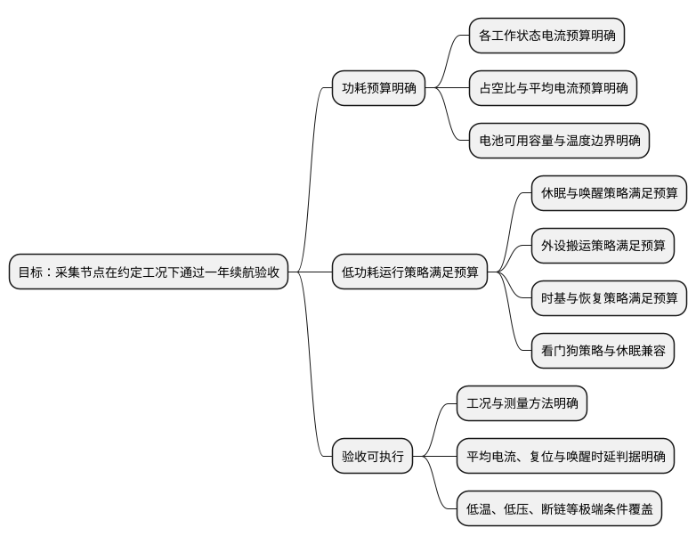

# 目标分解

**职责**：把已澄清需求转成目标树。根是原始目标，节点是目标，边是父子关系，叶子可直接匹配能力或验收。

**输入**：已澄清的标准化需求。

**输出**：目标树。

## 判据

- **每一层可判定**：根、中间节点、叶子都有完成条件或判定依据；根不可判定说明需求未澄清。
- **粒度合适**：过粗无法匹配能力，过细则退化成操作步骤。
- **目标纯粹**：只写结果或必须成立的条件，不写动作、能力选择或实现方案。
- **可追溯**：父子关系明确；无孤儿或重复；冲突有显式处理。
- **稳定**：等价表述应得到等价层级。

## 示例：电池供电采集节点

这棵树只写结果或必须成立的条件。`实现低功耗`、`配置看门狗`不是目标，因为它们没有完成条件；`STOP 模式`、`tickless idle`、`DMA`、`独立看门狗`属于后续的能力匹配，不属于目标树。
