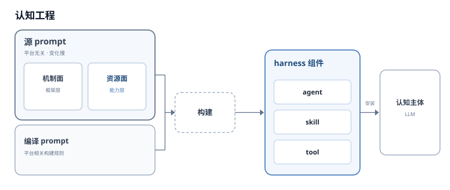
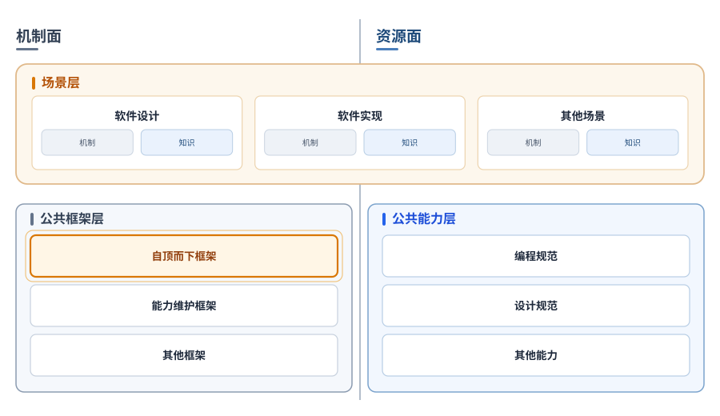
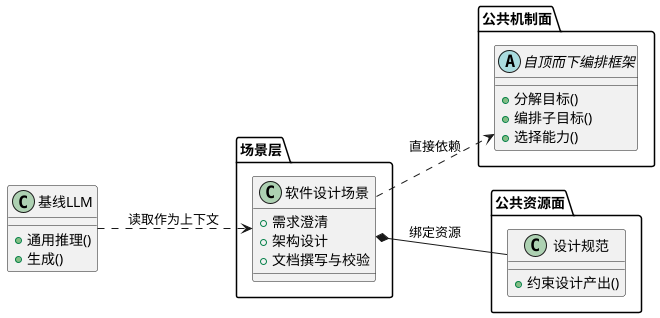
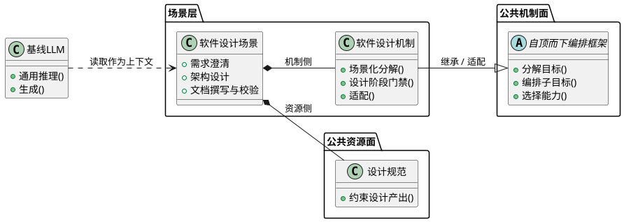
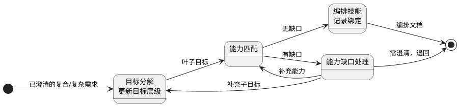
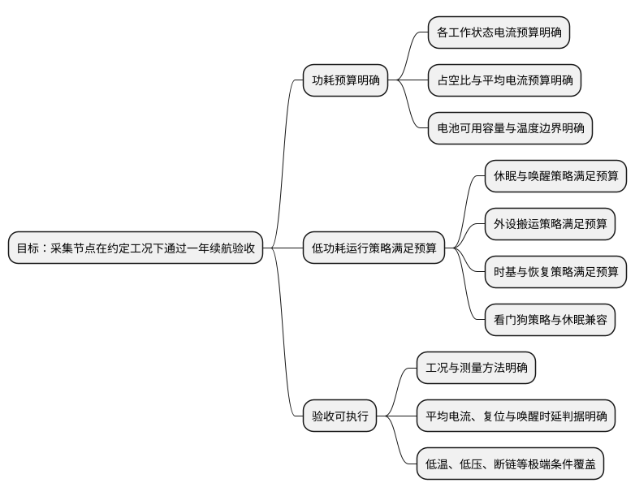

# 1. 术语

| 术语 | 定义 |
| :---: | :--- |
| 认知主体 | 面对任务、调用认知能力的主体；本文指人类开发者或 LLM 助手。 |
| 单反射弧技能调用 | 主体感知任务特征后，不经显式目标分解与调用理由评估，直接激活最匹配的技能模块或生成路径的调用模式；文中简称单反射弧。 |
| 技能混用性对接失败 | 多个技能被同时部分激活、缺少目标空间对调用优先关系与从属关系的裁定时，产出局部合理但整体不可追责的拼接产物。 |
| 目标空间 | 以目标—子目标层级组织任务的空间；目标分解在其中形成多级树状层级。 |
| 能力匹配 | 把叶子目标映射到可调用能力，返回候选或缺口；能力如何组织、如何匹配由上层决定。 |
| 技能空间 | 以技能（可调用的能力单元）为基本单元的能力组织；给定目标层级的叶子节点，匹配或生成技能并产出该节点要求的输出。 |
| 目标牵引 | 技能调用由目标空间中的目标节点驱动，而不是由任务特征直接触发。 |
| 自顶而下编排框架 | 以目标分解、子目标编排、能力匹配与选择为主线的微内核框架：只规定稳定骨架与扩展点，场景可在自己的机制层继承和适配。 |
| 基线 LLM | 未经 harness 注入、提供通用推理与生成能力的 LLM。 |
| harness | 承载 prompt、skill、workflow、agent 等构件，为认知主体提供注入与运行环境的平台。 |
| 认知工程 | 把 prompt 分为源 prompt 与编译 prompt，并用二者构建 harness 组件（agent、skill、tool 等）的工程；组件再安装到认知主体使用。 |
| 源 prompt | 平台无关、变化较慢的 prompt 部分；由机制面与资源面构成，另由场景层绑定具体任务情境。 |
| 编译 prompt | 平台相关、提供构建规则的 prompt 部分；与源 prompt 一起构建 harness 组件。 |
| 认知模块 | 按认知职责切分的模块；完成业务目标的置于资源面，负责组织与维护的置于机制面。 |
| 机制面 | 源 prompt 的两个组织面之一；放置元认知模块（负责组织、维护其他认知模块的模块），回答“怎么组织”。不随场景特化的部分称公共机制面。 |
| 资源面 | 源 prompt 的两个组织面之一；放置对业务功能负责的认知模块，回答“做什么”。不随场景特化的部分称公共资源面。 |
| 场景 | 具体任务情境，如软件设计、软件实现；每个场景由机制侧与资源侧的组合构成。 |
| 场景层 | 横跨机制面与资源面、由若干场景组成的绑定层；不是第三个平面。 |
| 场景机制层 | 场景内部承载机制绑定的部分；可继承自顶而下编排框架，并补充场景特有的分解、门禁与适配逻辑。 |

---

# 2. 背景与诉求

认知主体(无论是人类开发者还是LLM助手)在面对任务时，通常并不缺乏可调用的“能力”。
> 例如，LLM携带的基线能力，或是通过harness注入的skill、workflow等。
> 又比如人类开发者掌握的编程语言、框架、调试工具、领域经验，以及团队内沉淀的规范与流程。

当任务的特征足够简单、与某一技能的触发条件足够直接时，条件反射式的响应即可完成任务。
然而，一旦任务复杂度上升，这种“单反射弧”式的调用模式便暴露出两类失败。

第一类是知识完全缺失导致的启动失败：主体面对任务时没有任何可复用的技能，调用过程无从发起。
> 例如，要求LLM为一个没有文档的私有二进制协议写解析器。假设 harness 没有注入协议资料，也没有提供“从抓包反推协议”的方法；
> 模型既没有该协议的字段定义，也没有足够的逆向经验，只能编造字段名和字节序，或者反复要求用户补充它自己也说不清的信息。

第二类更为隐蔽：当任务需要多个技能的序列化协作、层级化嵌套或条件化选择时，特征-技能的直接映射便不再充分。
此时，多个技能可能同时被部分激活，而没有任何机制裁定“哪一项调用在当前目标下是必要的、哪一项是过早的”。
这种现象可以称为技能混用性对接失败：主体产出了一个在局部上似乎合理、在整体目标上却无法被追责的拼接产物。
> 例如，一位嵌入式开发者被要求“把电池供电的采集节点做到一颗电池撑一年”。
> 休眠模式、降主频、关外设时钟、DMA 搬运、独立看门狗、RTOS 的 tickless idle、传感器 FIFO 中断——这些知识几乎同时被激活，每一条都足够熟悉，于是他把它们都写进了方案：
> 主循环进 STOP 模式，看门狗配 8 ms 超时；ADC 走 DMA 每 1 ms 搬一帧；传感器开 FIFO 阈值中断；SysTick 保留 1 kHz 给系统时基；串口降到 9600 波特率省电。
> 每一层单独看都有合理的唤醒源与关断条件，评审时也能逐条自圆其说；但整份方案没有回答“这次到底能睡多久由谁决定、醒来后由谁恢复被降频的时钟树、看门狗在哪个上下文里喂”。
> 样机上车后，STOP 期间独立看门狗照常计数，节点每隔 8 ms 复位一次；
> 把超时放宽后，DMA 的 1 ms 唤醒又让平均电流几乎没降；偶发的 FIFO 中断在时钟尚未恢复时读 SPI，采到的数据整体错位半个字节。

LLM 只是把这一过程压缩到一次回答里：面对同样的需求，它会同时援引 STOP 模式、DMA、tickless idle 和看门狗超时的“最佳实践”，
输出一份面面俱到的方案，却很少先问这些实践是否共享同一套时序与功耗前提。输出越完整，越难看出其中没有一条贯穿始终的取舍。

值得强调的是，这两类失败的根源都不在于主体拥有的技能“不够多”或“不够好”。
启动失败可以在能力库规模扩张后依然发生——因为缺口的识别本身需要坐标；
混用性对接失败甚至可能因技能增多而加剧——因为可被部分激活的候选集合变大了。
问题的结构性在于：技能以特征触发的方式被调用时，没有一个独立于技能的层面来裁定调用之间的优先关系与从属关系。这一层面就是目标空间。

---

# 3. 目标

给出`自顶而下编排`的定义和使用方式，用于复合任务、复杂任务的通用能力匹配、编排。
该框架可供基线LLM直接感知，提供通用的认知能力；或由领域基于框架注入具体实现，再交由LLM感知，提供领域特化的认知能力。

---

# 4. 场景设计

## 4.1. 顶层场景设计

建议将`自顶而下编排框架`应用于`认知工程`中。`认知工程`由源prompt与编译prompt构成，旨在分离平台相关与平台无关的内容。


建议将源prompt分为机制面和资源面两栈。


资源面和机制面是根据解决目标区分的。
- 完成业务目标，对功能负责的认知模块放在资源面，例如撰写高质量的代码、TDD开发流程等。
- 负责组织、维护认知模块的元认知模块放在机制面。例如如何迭代认知模块、如何组织认知模块等。
- 资源面和机制面是平级的，类似网络架构中的控制面和数据面。

场景层横跨资源面和机制面，每个场景有意识地将自己的领域知识按机制和资源分类。
- 资源面回答“做什么”：这个场景要完成什么业务目标、调用哪些业务知识与能力。例如软件实现场景偏向编程规范。
- 机制面回答“怎么组织”：这个场景如何分解目标、如何选择和维护能力、失败后如何迭代。

## 4.2. 交互关系设计

`自顶而下编排框架`是微内核架构，提供思路但不提供解决方案。
对于比较简单的，依赖基线LLM能力即可达成的场景，可以直接依赖该公共框架。



`自顶而下编排框架`作为一种`抽象基类`，在场景较为复杂时，可以在场景独有的机制层继承其思想，并做更契合场景的适配、改造。



---

# 5. 实现设计

## 5.1. 主张与理念

主体在动手之前，需要完成自顶而下的目标分解，将“要做什么”与“会做什么”在架构上分离开来，形成目标-子目标的多级树状层级；
然后再将叶子节点提取出来，逐个在技能空间等能力组织中匹配，完成目标—能力对应，以克服单反射弧模式的结构性缺陷。
> 这一概念的认知架构根源可以追溯至Newell所倡导的“统一认知理论”纲领。
> Newell主张，认知架构应当在问题空间中组织全部任务求解行为：状态、算子与目标构成了行为的基本坐标系，而非零散的刺激-反应联结。
>
> 在Soar架构中，这一思想获得了机制层面的实现：当主体在当前问题空间中无法继续推进时，系统检测到僵局，并自动创建一个子目标。
> 子目标形成新的问题空间，其目标正是获取缺失的知识或解决导致僵局的冲突。
> 这意味着目标层级不是预先给定的静态计划，而是在求解过程中由认知失败动态地、按需地生长出来的。
> 正如`U盘`和`块设备`的关系那样，`U盘`是`块设备`的一种实现，`soar`也是`自顶而下思维框架`的一种实现，并不是其定义。

这一分离使技能调用从“特征触发”转变为“目标牵引”：
1. 能力缺口从模糊的“不知道怎么做”转化为可定位的“目标坐标上缺少哪一项技能”
2. 能力不再被混用。因为每一个能力都有明确的目标牵引。

目标分解还带来了如下好处。
1. 决策可审计。无论是团队协作，还是开发者&LLM协作场景，都可以先通过目标分解明确和对齐思路，避免后续返工。
2. 能力可迭代。目标往往是稳定，能力则会随着项目的积累而变化；由于目标分解解耦了决策和实现，使得能力可以脱离项目独立迭代。

## 5.2. 架构设计



1. **目标分解**：在目标空间中自顶而下分解，产出可被能力匹配的叶子目标。
2. **能力匹配**：逐个叶子目标在能力组织中匹配或生成能力；区分有匹配与有缺口。
3. **能力缺口处理**：缺口记录为目标坐标上的能力缺口，补子目标、补能力或退回澄清。
4. **编排并记录绑定**：按目标层级确定技能调用的先后、依赖与从属，记录目标—技能绑定。

编排文档包含目标层级、目标—技能绑定与技能调用编排。执行、校验与交付由后续环节承担。

### 5.2.1 目标分解

目标分解把已澄清的标准化需求转成目标—子目标层级，并暴露可被能力匹配的叶子目标。产物是一棵子目标树：根是原始目标，节点是目标，边是父子关系，叶子是可直接匹配能力或验收的子目标。
它定义后续匹配的坐标系；评价重点不是分解手法，而是分解结果是否可用。好的分解应满足：
- **可判定**：每个节点（含根与中间节点）都有完成条件或判定依据；根不可判定意味着诉求尚未澄清；叶子目标还要可被能力匹配。
- **粒度合适**：过粗无法匹配能力，过细则退化成操作步骤；分解停在“可匹配”处。
- **目标纯粹**：所有节点只写要达成的结果或必须成立的条件，不写动作、能力选择或实现方案；不以现有能力反推目标。
- **可追溯**：父子关系明确，每个子目标能说明对父目标的贡献；无孤儿或重复目标，冲突有显式处理。
- **稳定**：同一意图的等价表述应得到等价层级，不因措辞变化改变结构。

**示例（仅示结构）**

假设输入已澄清为：给定电池型号、采集周期、传感器与 MCU 型号、温度范围，要求采集节点用一颗电池撑一年。



这棵树只写结果或必须成立的条件，不写动作：

- 每一层（含根）都可判定：根看“一年续航验收是否通过”，中间节点看“子目标是否全部成立并满足节点自身约束”，叶子看具体判据。
- `实现低功耗`/`配置看门狗`不是目标，因为它们没有完成条件；它们应被`休眠与唤醒策略满足预算`、`看门狗策略与休眠兼容`这类结果替代。
- 根不可判定（例如只写“把功耗做低”而没有工况和验收）说明诉求尚未澄清，不能进入分解。
- 叶子是匹配坐标：`休眠与唤醒策略满足预算`需要低功耗模式知识，`看门狗策略与休眠兼容`需要看门狗时序知识；找不到就记缺口，不在树里编造。
- `STOP 模式 / tickless idle / DMA / 独立看门狗`属于 5.2.2 的能力匹配，不属于目标树。
- 若电池资料或传感器时序缺失，`电池可用容量与温度边界明确`等叶子就是能力缺口，不应进入实现。
- 这些叶子故意覆盖不同匹配情形：直接匹配、多候选比较、无匹配或缺口；例如休眠策略有多个候选、`工况与测量方法明确`可直接匹配测量方法知识、电池容量可能没有可用知识、看门狗与休眠存在冲突候选。
- 同一需求换一种说法重新分解，目标与父子关系应保持等价；这是目标分解的稳定性判据。

### 5.2.2 能力匹配

能力匹配把叶子目标映射到可调用能力。它的职责是建立目标—能力对应关系，而不是替目标做决定。候选可以是完整覆盖、部分覆盖（带残余缺口）或缺口。
能力可以组织为技能、知识、布鲁姆六维等形态，具体由能力组织框架、或是上层决定。

好的匹配应满足：
- **目标先行**：先有叶子目标，再匹配能力；不以能力库反推任务。
- **匹配可解释**：能说明能力为什么满足该目标（适用条件、输入输出、约束），不只靠名称或相似度。
- **候选可比较**：同一目标下能比较多个候选，并标注关系类型：组合、重叠、互斥、前置约束、资源竞争。
- **最小充分**：只取满足目标所需的能力，不因“可能有用”扩大候选集；这是防止技能混用的关键。
- **缺口可见**：无匹配或仅部分覆盖时，返回缺口或残余缺口；不强行匹配、不编造能力。
- **稳定**：同一目标与上下文下结果可复现；改述不改变结论，或差异可解释。

**示例（判据对照，不是匹配步骤）**

以 5.2.1 的叶子为例，评判一次匹配结果时逐条对照下表。所有候选都必须挂在该叶子目标下，不以能力库反推目标。

| 叶子目标 | 不合格结果 | 合格结果 | 触发的判据 |
|---|---|---|---|
| 工况与测量方法明确 | 给一个通用“用电流表测”的方法，不说明量程、采样率、占空比口径 | 给一个可执行的方法，并说明适用量程、采样率、测量口径与前提 | 目标先行、可解释 |
| 休眠与唤醒策略满足预算 | 把 STOP、standby、tickless idle、DMA、看门狗全部列为候选，不写适用条件与关系类型 | 只列与 MCU/RTOS 条件相容的休眠候选；标注适用条件，并按组合/重叠/互斥/前置/资源竞争标注关系；缺条件时记缺口 | 可解释、可比较、最小充分 |
| 看门狗策略与休眠兼容 | 直接选独立看门狗，不检查休眠期间是否计数、谁来喂、唤醒后如何恢复 | 候选附带“休眠期间是否计数、谁来喂、唤醒后如何恢复”的判定；不满足则拒绝 | 可解释、可比较、最小充分 |
| 电池可用容量与温度边界明确 | 编造容量或温度数据，或把通用电池知识当作已匹配 | 返回缺口，指出缺电池型号或温度曲线，交回补能力或澄清 | 缺口可见 |

一次结果只有在适用判据上全部通过才算合格；违反任一条即不合格。合格与否不看候选数量，而看候选是否对目标负责：有适用条件、有代价与冲突、没有无关能力、没有伪造匹配。同一叶子目标换一种表述或重复匹配，结果应稳定；否则不满足稳定判据。

边界：能力如何组织（技能、知识、布鲁姆六维等）与如何匹配（关键词、向量、生成）由上层或实现决定；框架只规定“目标→候选/缺口”的契约。

### 5.2.3 能力缺口处理

能力缺口处理把“没有可用能力”转成可定位、可决策的对象。它决定系统是静默编造，还是把缺口交给目标、能力维护或澄清。

好的缺口处理应满足：
- **显式定位**：缺口挂在具体目标坐标上，缺失类型只取四类：知识、方法、工具、约束；“文档缺失”“数据缺失”是证据形态，不是独立类型；多类型时显式记主类型。
- **可分类**：记录类别：目标不清、能力缺失、平台或权限限制；不同类别走不同出口。
- **可回流**：缺口能回到目标分解或能力匹配，形成下一轮，不是死路。
- **不越界**：框架不替用户补需求，也不静默生成“看起来能用”的能力；假设必须标记。
- **可积累**：缺口记录能进入能力维护，成为后续能力迭代的输入。
- **可控**：避免缺口爆炸或无限分解；缺口处理要有停止条件或优先级。

边界：补能力、补子目标、退回澄清的决策由场景或维护侧承担；框架只定义缺口记录与出口。

### 5.2.4 编排与绑定

编排与绑定把目标层级与能力匹配结果合成一份编排文档：每个调用实例挂在具体目标下，按目标层级确定先后、依赖与从属。
它是框架的终点，也是执行侧的输入。

编排文档至少包含：目标层级（目标 ID、父 ID、完成条件、是否叶子）、调用实例（调用 ID、目标 ID、能力/技能、输入、输出、理由）、依赖（from/to、端点类型、依赖类型、依据）、调用间约束（from/to、约束类型、依据）。

依赖类型定义：

- **层级**：父目标要求子目标或调用成立；至少一端为目标。
- **前置**：调用 B 需要调用 A 的结果或状态先成立。
- **产物**：B 的输入是 A 的输出。
- **门禁**：B 需要某个判定或批准结果（如测试通过、签名验证）。

端点必须显式标注“目标”或“调用”。

好的编排应满足：
- **调用实例单父**：一个能力可以产生多个调用实例；每个实例只有一个目标父节点；1:N 允许，孤儿禁止。
- **顺序有据**：先后、依赖来自目标层级、技能前置条件与产物依赖，并标注依赖类型与端点。
- **冲突显式**：跨目标的互斥、资源竞争、共享产物记入调用间约束，不只写在候选说明里。
- **最小充分**：只编排目标所需调用，不把候选全部塞进计划。
- **可审计**：记录调用 ID、目标—调用绑定、选择理由、依赖与输入输出；可复核、可复现。
- **可执行但不过界**：编排文档要足以交给执行侧，但不替执行侧规定实现细节；框架不执行、不校验。
- **可变更**：目标或能力变化时，绑定能局部更新，不形成不可拆的整体。

---

# 6. 规格与测试设计

本章给出`自顶而下框架`的规格树、业务规格、组件规格、验收点与测试设计。规格采用点分 ID 与 IPO 三要素。

## 6.1. 规格树

```text
spec.topdown-orchestration
├─ .target-decomposition
├─ .capability-matching
├─ .gap-handling
└─ .binding
```

| 规格 ID | 名称 |
|---|---|
| `spec.topdown-orchestration` | topdown-orchestration 支持 生成编排文档 |
| `spec.topdown-orchestration.target-decomposition` | topdown-orchestration 支持 目标分解 |
| `spec.topdown-orchestration.capability-matching` | topdown-orchestration 支持 能力匹配 |
| `spec.topdown-orchestration.gap-handling` | topdown-orchestration 支持 能力缺口处理 |
| `spec.topdown-orchestration.binding` | topdown-orchestration 支持 编排绑定 |

## 6.2. 业务规格

`spec.topdown-orchestration`

名称：`topdown-orchestration 支持 生成编排文档`

正文：`输入为已澄清的标准化需求时，topdown-orchestration 支持 生成编排文档，文档包含目标层级、目标—技能绑定与技能调用编排。`

| Input | Process | Output |
|---|---|---|
| 已澄清的标准化需求 | 目标分解 → 能力匹配 → 能力缺口处理 → 编排并记录绑定 | 编排文档 |

## 6.3. 组件规格

**`spec.topdown-orchestration.target-decomposition`**

名称：`topdown-orchestration 支持 目标分解`

正文：`输入为已澄清的标准化需求时，topdown-orchestration 支持 分解出可被能力匹配的叶子目标。`

- Input：已澄清的标准化需求
- Process：在目标空间中自顶而下分解，展开到叶子目标
- Output：目标层级与叶子目标

**`spec.topdown-orchestration.capability-matching`**

名称：`topdown-orchestration 支持 能力匹配`

正文：`目标层级已生成时，topdown-orchestration 支持 为每个叶子目标匹配或生成能力，并区分匹配与缺口。`

- Input：叶子目标
- Process：在能力组织中匹配或生成能力，判定匹配或缺口
- Output：能力候选或能力缺口

**`spec.topdown-orchestration.gap-handling`**

名称：`topdown-orchestration 支持 能力缺口处理`

正文：`能力匹配发现能力缺口时，topdown-orchestration 支持 记录缺口并给出处置出口。`

- Input：能力缺口（目标坐标 + 缺失描述）
- Process：记录缺口；选择补充子目标、补充能力或退回澄清
- Output：缺口记录与处置结果

**`spec.topdown-orchestration.binding`**

名称：`topdown-orchestration 支持 编排绑定`

正文：`目标层级与能力匹配结果已就绪时，topdown-orchestration 支持 生成编排文档。`

- Input：目标层级 + 能力匹配结果
- Process：按目标层级确定技能先后、依赖与从属，记录目标—技能绑定
- Output：编排文档（目标层级、目标—技能绑定、技能调用编排）

## 6.4. 验收点

| 验收点 | 预设条件 | 输入 | 输出 |
|---|---|---|---|
| `checkpoint.topdown-orchestration.target-decomposition.leaf_goal_complete` | 输入为已澄清的标准化需求 | 一份标准化需求 | 目标层级存在；每个叶子目标有完成条件；无孤儿目标 |
| `checkpoint.topdown-orchestration.target-decomposition.restatement_stable` | 两份等价表述的已澄清需求 | 两份需求 | 目标层级等价，目标与父子关系一致 |
| `checkpoint.topdown-orchestration.capability-matching.match_or_gap` | 目标层级已生成 | 叶子目标集合 | 每个叶子目标有完整候选、部分候选 + 残余缺口，或缺口；无匹配不返回伪造能力 |
| `checkpoint.topdown-orchestration.gap-handling.gap_traceable` | 存在能力缺口 | 缺口目标 | 缺口记录含目标坐标、类别、四类缺失类型之一、证据、处置出口与停止条件 |
| `checkpoint.topdown-orchestration.binding.every_skill_has_target` | 目标层级与能力候选已就绪 | 目标层级 + 匹配结果 | 每个调用实例有唯一目标父节点；允许 1:N；无孤儿 |
| `checkpoint.topdown-orchestration.binding.order_justified` | 编排文档已生成 | 编排文档 | 依赖含端点类型、类型（层级/前置/产物/门禁）与依据；调用间约束显式 |

## 6.5. 测试设计

测试设计分两层：**用例设计**回答“测什么、覆盖哪个验收点”；**用例实现设计**回答“用什么夹具、怎么执行、断言什么、留下什么证据”。

### 6.5.1. 用例设计

CT 为组件测试，IT 为集成测试。验收点与测试的对应关系即追溯矩阵。

| 测试 | 规格 | 验收点 | 预设条件 / 输入 | 断言 |
|---|---|---|---|---|
| CT-01 目标分解 | target-decomposition | leaf_goal_complete | 已澄清需求 | 目标层级存在；叶子有完成条件；无孤儿 |
| CT-02 改述稳定 | target-decomposition | restatement_stable | 两份等价需求 | 目标层级等价 |
| CT-03 能力匹配 | capability-matching | match_or_gap | 叶子目标 + 有匹配能力库 | 完整候选，或部分候选 + 残余缺口；无伪造 |
| CT-04 能力缺口 | capability-matching | match_or_gap | 叶子目标 + 无匹配能力库 | 返回缺口，不返回候选 |
| CT-05 缺口记录 | gap-handling | gap_traceable | 缺口目标 | 记录含目标坐标、类别、四类缺失类型之一、证据、处置出口与停止条件 |
| CT-06 绑定挂载 | binding | every_skill_has_target | 目标层级 + 匹配结果 | 每个调用实例单父；允许 1:N；无孤儿 |
| CT-07 顺序依据 | binding | order_justified | 编排文档 | 依赖带端点与类型（层级/前置/产物/门禁）及依据；调用间约束显式 |
| CT-08 部分覆盖 | capability-matching | match_or_gap | 叶子目标 + 只部分覆盖的能力 | 返回部分候选 + 残余缺口；不伪造完整覆盖 |
| IT-01 业务闭环 | orchestration | 全部 | 两份等价改述 + 夹具 | 生成编排文档；三部分齐全；全部验收点通过 |

用例设计的产出是测试清单与追溯矩阵；它不规定夹具与执行细节。

### 6.5.2. 用例实现设计

每个用例自带场景与夹具，不复用同一测试套；同一场景反复使用会让用例互相“教会”对方，掩盖真实缺陷。下面每条用例按场景、验收点、夹具、输入、执行/断言、证据展开。

#### 6.5.2.1 CT-01 目标分解

**场景**：为现有 CLI 增加 `--batch-import`，从目录批量导入 CSV，失败时返回逐行错误。

**验收点**：`checkpoint.topdown-orchestration.target-decomposition.leaf_goal_complete`

**夹具**：目标空间记录器；本用例不需要能力组织。

**输入**：一份已澄清的需求，含输入目录、CSV 格式、失败输出要求；明确逐行提交（失败行不写入）；重复 `id` 按整批判定，跨文件按路径字典序、再按行号确定首行，首行成功、后续重复行失败；表头不符、非 UTF-8、零成功行统一按失败处理；行级错误输出文件/行/原因，文件级错误输出文件/原因，退出码非 0。

**执行/断言**：调用目标分解；断言目标层级存在，叶子目标有完成条件，无孤儿目标；失败行零写入与重复 `id` 失败必须出现在目标树中。

**证据**：目标树快照与输入摘要。

#### 6.5.2.2 CT-02 改述稳定

**场景**：同一“报表导出”需求的两份等价表述：A“把报表导出为 Excel”，B“把报表数据落成 Excel 文件”；目标与验收不变。

**验收点**：`checkpoint.topdown-orchestration.target-decomposition.restatement_stable`

**夹具**：两个独立的目标空间记录器；不共享缓存。

**输入**：两份等价需求文本，并显式共用同一验收条件。

**执行/断言**：分别分解；断言两棵树都引用同一验收 ID，目标与父子关系等价，措辞差异不影响结构。

**证据**：两棵目标树与结构 diff。

#### 6.5.2.3 CT-03 能力匹配

**场景**：电池采集节点的叶子目标“休眠与唤醒策略满足预算”；MCU 支持 STOP，系统使用 RTOS。

**验收点**：`checkpoint.topdown-orchestration.capability-matching.match_or_gap`

**夹具**：能力组织桩，目录含 `stop-mode`（与看门狗互斥）、`tickless-idle`（需 RTOS，与 stop-mode 组合）、`dma`（不是休眠/唤醒策略）。

**输入**：上述叶子目标与上下文。

**执行/断言**：返回 `stop-mode`、`tickless-idle`；排除 `dma`；每个候选带适用条件，并只标注实际适用的关系类型（本例为组合与前置）；看门狗互斥作为跨目标约束交给编排阶段；无伪造候选。

**证据**：能力目录快照、匹配结果与理由。

#### 6.5.2.4 CT-04 能力缺口

**场景**：私有二进制协议解析器的叶子目标“字段与校验可判定”；没有协议文档或抓包字段表。

**验收点**：`checkpoint.topdown-orchestration.capability-matching.match_or_gap`

**夹具**：能力组织桩为空，或只含无关的通用 JSON 解析能力。

**输入**：上述叶子目标。

**执行/断言**：返回缺口；不返回候选；不编造字段名或字节序。

**证据**：缺口对象与空目录快照。

#### 6.5.2.5 CT-05 缺口记录

**场景**：旧系统数据库迁移到 PostgreSQL 15，缺少 schema 文档；缺口处理需给出处置出口。

**验收点**：`checkpoint.topdown-orchestration.gap-handling.gap_traceable`

**夹具**：缺口记录器，目标坐标为“迁移脚本在目标库版本上可生成，并通过样例库演练（表/列/约束/索引一致）”。

**输入**：缺口对象（目标坐标、缺失描述）。

**执行/断言**：记录包含目标坐标、类别（能力缺失）、四类缺失类型之一（知识/方法/工具/约束；schema 文档缺失作为证据）、处置出口（补能力、补子目标或退回澄清）与停止条件；不是笼统的“做不到”。

**证据**：缺口记录与处置结果。

#### 6.5.2.6 CT-06 绑定挂载

**场景**：代码评审任务的三个结果目标“接口契约偏差已判定”“并发风险已判定”“测试覆盖充分性已判定”已有匹配能力，需形成绑定。

**验收点**：`checkpoint.topdown-orchestration.binding.every_skill_has_target`

**夹具**：目标树、已匹配能力、编排文档读取器；显式指定 `diff-context` 被三个目标共享，`review-summary` 汇总三个子结论。

**输入**：目标树与匹配结果（`diff-context` 在每个目标下各产生一个实例）。

**执行/断言**：每个调用实例都有唯一目标父节点；`diff-context` 产生 3 个实例（1:N）；无孤儿；汇总调用的父目标是根目标。

**证据**：编排文档的绑定表。

#### 6.5.2.7 CT-07 顺序依据

**场景**：发布流程目标“构建→测试→签名→部署”；能力前置条件要求测试消费构建产物、签名消费测试通过结果。

**验收点**：`checkpoint.topdown-orchestration.binding.order_justified`

**夹具**：目标树、匹配能力、前置条件、编排文档读取器。

**输入**：目标树与匹配结果。

**执行/断言**：先后与依赖可追溯到目标层级或能力前置条件；每条依赖标注端点（目标/调用）与类型（层级/前置/产物/门禁）之一；无无依据顺序；跨目标互斥或资源竞争若存在，必须出现在调用间约束中。

**证据**：编排文档的顺序、依赖与理由。

#### 6.5.2.8 CT-08 部分覆盖

**场景**：为内部 API 增加审计日志；叶子目标“审计日志可追溯”要求字段、格式与保留期都可判定。

**验收点**：`checkpoint.topdown-orchestration.capability-matching.match_or_gap`

**夹具**：能力目录只有 `structured-logger`，它覆盖字段与格式，不覆盖保留期；没有 `retention-policy` 能力。

**输入**：上述叶子目标与能力目录。

**执行/断言**：返回部分候选 `structured-logger`，`coverage=partial`，列出 `covered_conditions`（字段、格式）与残余缺口（保留期）；不标完整覆盖；不编造保留期能力。

**证据**：部分候选的覆盖说明与残余缺口记录。

#### 6.5.2.9 IT-01 业务闭环

**场景**：把一批 Markdown 文档迁移到新目录结构并生成索引；输入已澄清。

**验收点**：全部 6 个验收点。

**夹具**：真实四个组件串联，仅外部 LLM 用桩；显式指定 `md-scan` 被三个目标共享（1:N），并故意移除 `link-rewrite`，使“内部链接可解析”叶子产生一个缺口；其余能力完整。

**输入**：迁移需求的两份等价改述（共用同一验收 ID `ACC-MIG-01`）、文档清单、目标目录规则、索引要求。

**执行/断言**：生成编排文档；目标层级、目标—调用绑定、调用编排齐全；两份改述得到等价目标结构并引用同一验收 ID；`md-scan` 产生 3 个单父实例；`link-rewrite` 缺口可追溯；全部 6 个验收点通过。

**证据**：编排文档与 6 条验收点结果。

**执行与报告**

每个用例输出一条记录：测试 ID、规格 ID、验收点 ID、场景与夹具版本、输入摘要、实际输出、断言结果、证据路径。用例独立重跑，不共享夹具或执行顺序。失败先分类为规格歧义、实现缺陷、测试缺陷；规格歧义回到 6.2 修规格，不通过修改断言让失败消失。

**验收**

6 个验收点均有 CT，IT-01 通过；追溯矩阵无孤儿验收点或测试；证据可复核。

---

# 7. 认知工程结构

本工程按认知工程组织：

- `source_prompt/`：平台无关知识源，入口 `source_prompt/README.md`。
- `compile_prompt/`：编译规则，入口 `compile_prompt/README.md`。
  - `opencode/`：编译为 standalone skill，任意 agent 可触发。
  - `嵌入说明.md`：作为更大认知工程的源域，参与宿主编译。
- `build/<platform>/`：编译产物，不手写。

`source_prompt` 是唯一事实源；换平台只新增编译子目录，不改源。`build/opencode/` 已生成，可直接按 `build/opencode/使用指引.md` 做热插拔；它仍由编译规则生成，不手改。
